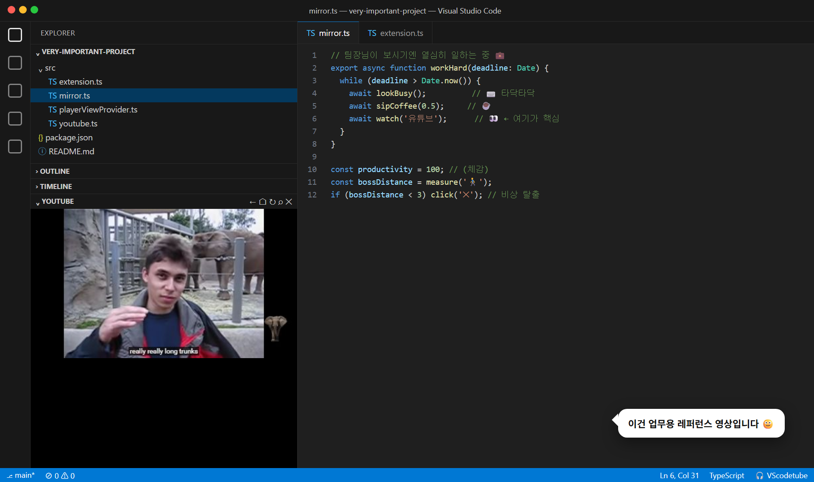
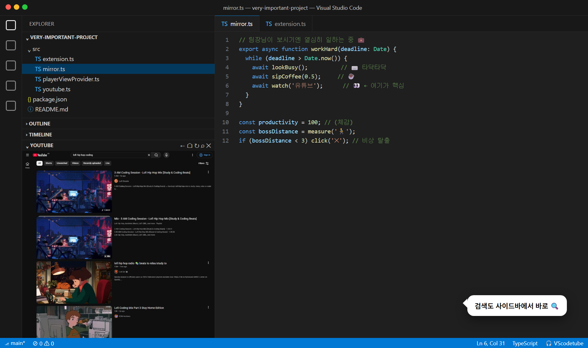
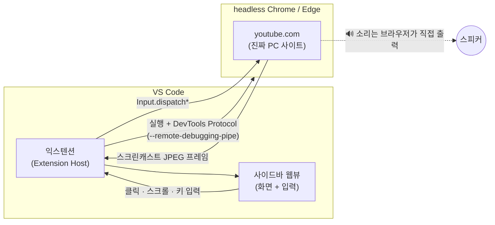

<div align="center">


# VScodetube

### VS Code Explorer 사이드바에 YouTube를 몰래 심어 두는 익스텐션

**겉으로는 TypeScript, 사이드바에서는 lofi hip hop.**

[](https://code.visualstudio.com/)
[](src)
[](package.json)
[](#설치)
[](https://marketplace.visualstudio.com/items?itemName=leejaehaeng.vscodetube)
[-ff0033?style=flat-square&logo=youtube&logoColor=white)](#면책-조항)

[이게 뭔가요](#이게-뭔가요) · [설치](#설치) · [사용법](#사용법) · [설정](#설정) · [어떻게 동작하나요](#어떻게-동작하나요) · [삽질 연대기](#삽질-연대기) · [FAQ](#faq)

</div>

> [!WARNING]
> 이 익스텐션은 **업무 효율을 보장하지 않습니다.** 팀장님 발소리가 들리면 상단 `✕` 버튼을 누르세요. 브라우저까지 통째로 꺼집니다.

<div align="center">

<sub>↑ 실제 동작 화면을 합성한 연출 컷. 에디터의 코드는 연기입니다.</sub>
</div>

---

## 이게 뭔가요

VS Code의 **Explorer 사이드바 하단**(Outline · Timeline 옆)에 **YouTube** 섹션을 하나 추가합니다.

링크를 복붙해서 영상 하나만 띄우는 플레이어가 아니에요. **YouTube 사이트를 그대로** 사이드바에 넣었습니다. 검색하고, 썸네일을 클릭하고, 댓글까지 내려 볼 수 있어요. 에디터는 그대로 두고요.

- 🔍 **사이드바 안에서 검색·탐색.** PC 버전 YouTube를 섹션 크기에 맞게 축소해서 보여 줍니다.
- 🎬 **영상을 누르면 꽉 채우기.** 플레이어가 섹션을 가득 채우고, `Esc`를 누르면 원래 페이지로 돌아갑니다.
- 🎧 **딴 데 가도 계속 재생.** 검색 탭으로 가거나 섹션을 접어도 소리는 계속 나옵니다.
- ⌨️ **한글 입력과 `Ctrl+V` 붙여넣기**를 지원합니다.
- 🙈 **"유료 광고 포함" 딱지를 숨깁니다.** 영상 위에 떠 있던 그거요.
- 🌗 **VS Code 테마를 따라** YouTube도 다크/라이트로 바뀝니다.
- 💾 **마지막으로 보던 페이지를 기억합니다.** 다시 열면 영상은 일시정지 상태로 복원돼요.

<div align="center">

</div>

## 설치

**준비물:** VS Code 1.140 이상 + **Chrome 또는 Edge** (재생을 맡습니다)

### 방법 1. VS Code 마켓플레이스 (추천, 10초 컷)

[](https://marketplace.visualstudio.com/items?itemName=leejaehaeng.vscodetube)

- VS Code 확장 탭(`Ctrl+Shift+X`)에서 **`VScodetube`** 를 검색하고 **설치**를 누르세요.
- 또는 터미널에서 한 줄로 설치할 수 있어요.

```bash
code --install-extension leejaehaeng.vscodetube
```

설치가 끝나면 Explorer 맨 아래에 **YOUTUBE** 섹션이 생깁니다. 안 보이면 `Ctrl+Shift+P` → `Developer: Reload Window`를 실행하세요.

### 방법 2. 소스에서 직접 빌드

코드를 고쳐 보고 싶은 분께 추천해요. 3분이면 됩니다(유튜브 한 편보다 짧음). Node.js 22 이상이 필요해요.

```bash
git clone https://github.com/LeeJaeHaeng/workplace-slacker.git
cd workplace-slacker
npm install
npx @vscode/vsce package
code --install-extension vscodetube-0.0.1.vsix
```

## 사용법

| 버튼 | 하는 일 |
|:---:|---|
| `←` | 뒤로 가기 |
| `⌂` | YouTube 홈 |
| `↻` | 새로고침 (YouTube가 삐졌을 때) |
| `🔍` | 검색어, 영상 URL, 영상 ID 중 아무거나 넣으면 알아서 처리 |
| `✕` | 브라우저 종료. **비상 탈출 버튼** |

**팁**

- 사이드바 화면은 **진짜 YouTube**라서 클릭, 스크롤, 타이핑이 그대로 먹힙니다.
- 영상을 누르면 플레이어가 섹션을 꽉 채웁니다. 화면을 한 번 클릭한 뒤 `Esc`를 누르면 PC 레이아웃의 영상 페이지(댓글, 추천 영상)로 돌아가요.
- 섹션 제목을 드래그해서 **우측 보조 사이드바**(`Ctrl+Alt+B`)로 옮기면 훨씬 넓게 볼 수 있습니다. 강력 추천.
- `Ctrl` 조합 단축키는 VS Code로 넘어갑니다. 예외는 `Ctrl+V` 하나예요(YouTube에 붙여넣기).

## 설정

| 설정 | 기본값 | 설명 |
|---|:---:|---|
| `vscodetube.autoplay` | `true` | 🔍로 영상을 열 때 자동 재생 |
| `vscodetube.autoFullscreen` | `true` | 영상을 열면 플레이어로 섹션을 꽉 채움 |
| `vscodetube.restoreLastVideo` | `true` | VS Code를 다시 열면 마지막 페이지 복원 (영상은 일시정지) |
| `vscodetube.pageWidth` | `1280` | YouTube를 렌더링할 PC 화면 폭. 줄이면 글자가 커지고, 너무 줄이면 모바일 같은 레이아웃이 됨 |
| `vscodetube.hidePaidPromotion` | `true` | 영상 위 "유료 광고 포함" 안내 숨김 (브라우저를 다시 열면 적용) |
| `vscodetube.browserPath` | `""` | 재생용 브라우저 경로. 비우면 Chrome → Edge 순으로 자동 탐색 |

## 어떻게 동작하나요

VS Code 웹뷰에 YouTube를 바로 넣으면 **재생이 안 됩니다.** (자세한 사연은 [삽질 연대기](#삽질-연대기)에) 그래서 이렇게 돌아갑니다.



1. 익스텐션이 시스템 Chrome(없으면 Edge)을 **창 없이(headless)** 띄우고, 전용 프로필로 `youtube.com`을 엽니다.
2. Chrome DevTools Protocol의 `Page.startScreencast`로 화면을 프레임 단위로 받아 사이드바에 그립니다.
3. 사이드바에서 생긴 클릭, 휠, 키 입력은 좌표를 환산해서 `Input.dispatchMouseEvent` / `Input.dispatchKeyEvent` / `Input.insertText`로 돌려보냅니다.
4. 브라우저와는 열린 포트 없이 **표준 입출력 파이프**(`--remote-debugging-pipe`)로만 통신합니다. 다른 프로그램이 끼어들 틈이 없어요.
5. **런타임 npm 의존성은 0개**입니다. Node 내장 모듈(`child_process`, `crypto`, `fs`, `path`, `stream`)만 씁니다.

```
src/
├─ extension.ts           # 명령 등록, 뷰 연결
├─ playerViewProvider.ts  # 사이드바 웹뷰: 프레임 표시, 입력 수집, 설정 반영
├─ mirror.ts              # headless 브라우저 실행 + 최소 CDP 클라이언트 + 꽉 채우기 모드
├─ youtube.ts             # URL/검색어 해석 (parseVideoId, resolveInput)
└─ test/youtube.test.ts   # 단위 테스트
```

## 삽질 연대기

> "그냥 iframe 하나 넣으면 되는 거 아님?" — 첫날의 나

<details>
<summary><b>1화. Error 153: Referer가 없잖아요</b></summary>

VS Code 웹뷰는 `vscode-webview://`라는 특수 주소에서 돌아서 HTTP `Referer` 헤더를 보내지 않습니다. YouTube는 이런 임베드를 **Error 153**으로 막습니다.
→ `127.0.0.1`에 작은 HTTP 서버를 띄워 iframe을 한 겹 더 감쌌습니다.
</details>

<details>
<summary><b>2화. "이 동영상은 볼 수 없습니다": IP 주소는 싫대요</b></summary>

`127.0.0.1` 출처는 일부 영상에서 거부됐습니다. 크롬으로 나란히 비교해 보니 `localhost`에서는 멀쩡했어요. 호스트 이름 하나로 해결.
</details>

<details>
<summary><b>3화. "An error occurred": 범인은 Opus</b></summary>

이번엔 플레이어는 뜨는데 재생 버튼을 누르면 에러가 났습니다. VS Code 웹뷰 안에서 코덱을 하나씩 직접 재생해 보니 이랬어요.

| 코덱 | VS Code 웹뷰 |
|---|---|
| H.264 + AAC | ✅ |
| VP8 / VP9 | ✅ |
| **Opus 오디오** | ❌ 지원한다고 대답해 놓고 실제로는 못 풂 |

YouTube는 크롬 계열에 VP9 + **Opus**를 보냅니다. VS Code는 "Opus 돼요!"라고 해 놓고 재생은 못 해요. iframe 안의 YouTube가 고르는 코덱에는 익스텐션이 끼어들 방법이 없습니다.
→ **재생은 진짜 Chrome에 맡기고, 화면만 비춰 오기로 했습니다.** (지금 구조의 탄생)
</details>

<details>
<summary><b>4화. 사이드바가 모바일이 됐다</b></summary>

사이드바 폭(약 380px)으로 렌더링했더니 YouTube가 모바일 레이아웃을 줬습니다. 앱 설치 유도 팝업은 덤.
→ **PC 폭(1280px)으로 렌더링한 뒤 비율 그대로 축소**합니다. 클릭 좌표도 같은 비율로 환산해요.
</details>

<details>
<summary><b>5화. YouTube가 내 CSS를 지운다</b></summary>

플레이어를 꽉 채우려고 `<style>`을 넣었더니 YouTube가 페이지를 로딩하면서 지워 버렸습니다. 거기에 첫 방문 때는 테마를 맞추려고 페이지를 몰래 새로고침(`&themeRefresh=1`)까지 해요.
→ YouTube가 건드리지 않는 `document.adoptedStyleSheets`로 주입하고, 새 문서가 로드될 때마다 다시 적용합니다.
</details>

<details>
<summary><b>6화. "Something went wrong": 로봇이세요?</b></summary>

잘 보다가 갑자기 에러가 떴습니다. headless 브라우저는 `navigator.webdriver = true`에 Client Hints 브랜드 목록도 텅 비어 있어요. 딱 봐도 로봇이죠.
→ 일반 Chrome과 같은 UA, Client Hints를 설정하고 `AutomationControlled`를 껐습니다. 이후 광고 포함 2분 넘게 연속 재생해도 문제가 없었습니다.
</details>

## FAQ

<details>
<summary><b>왜 굳이 Chrome/Edge가 필요한가요?</b></summary>

VS Code에 들어 있는 브라우저 엔진은 Opus 오디오를 재생하지 못해서 YouTube 영상이 멈춥니다. 그래서 재생은 시스템 Chrome이 맡고, VS Code는 화면만 보여 줍니다.
</details>

<details>
<summary><b>광고가 나와요. 로그인은 안 되나요?</b></summary>

재생용 브라우저는 개인 브라우저와 분리된 **전용 프로필**을 씁니다. 그래서 처음엔 로그인되지 않은 상태라 광고가 나올 수 있어요. 사이드바 화면에서 직접 로그인을 시도해 볼 수는 있지만, Google이 자동화 브라우저 로그인을 막을 수 있습니다.
</details>

<details>
<summary><b>"Something went wrong"이 떠요</b></summary>

상단 `↻` 새로고침 버튼을 눌러 보세요. 계속 나오면 `✕`로 닫았다가 `⌂`로 다시 여세요.
</details>

<details>
<summary><b>CPU를 얼마나 먹나요?</b></summary>

화면이 보일 때만 프레임을 받아 옵니다. 다른 탭으로 가거나 섹션을 접으면 프레임 전송을 멈추고 소리만 재생돼요. 그래도 영상 재생 중에는 Chrome 탭 하나 정도는 씁니다.
</details>

<details>
<summary><b>문제가 생기면 어디를 보나요?</b></summary>

`출력(Output)` 패널에서 **VScodetube** 채널을 고르세요. 브라우저 실행, 연결, 첫 프레임, 에러가 단계별로 남습니다.
</details>

## 알려진 제한

- 재생에 **Chrome 또는 Edge**가 필요합니다.
- 화면은 JPEG 프레임으로 비추는 방식이라 빠른 장면에서는 약간 끊겨 보일 수 있습니다(측정값 약 15fps 안팎).
- 연령 제한처럼 로그인이 필요한 영상은 볼 수 없습니다.
- VS Code 원격 환경(SSH, WSL, Codespaces)과 macOS·Linux에서는 아직 테스트하지 않았습니다. Windows 11에서만 확인했어요.

## 개발

```bash
npm install
npm run compile   # 타입 체크 + lint + esbuild
npm test          # 단위 테스트 (VS Code 테스트 인스턴스에서 실행)
```

`F5`로 Extension Development Host를 띄워 디버깅할 수 있습니다. 설계 초안은 [`VScodetube_IMPLEMENTATION_PLAN.md`](VScodetube_IMPLEMENTATION_PLAN.md)에 있어요. 초안의 "로컬 서버 + 이중 iframe" 구조는 [삽질 연대기](#삽질-연대기)를 거치면서 지금의 미러링 구조로 바뀌었습니다.

## 라이선스

[MIT](LICENSE)

## 면책 조항

- 이 익스텐션은 YouTube나 Google과 아무 관계가 없습니다. YouTube [이용약관](https://www.youtube.com/t/terms)을 지켜 주세요.
- **업무 시간 시청으로 생기는 인사상 불이익, 마감 지연, 팀장님과의 어색한 눈맞춤**에 대해 개발자는 책임지지 않습니다.
- 회사의 보안 정책이나 소프트웨어 설치 규정이 허용하는 범위에서만 쓰세요.

<div align="center">

**오늘도 커밋은 초록색, 마음은 빨간색(▶).**

</div>
